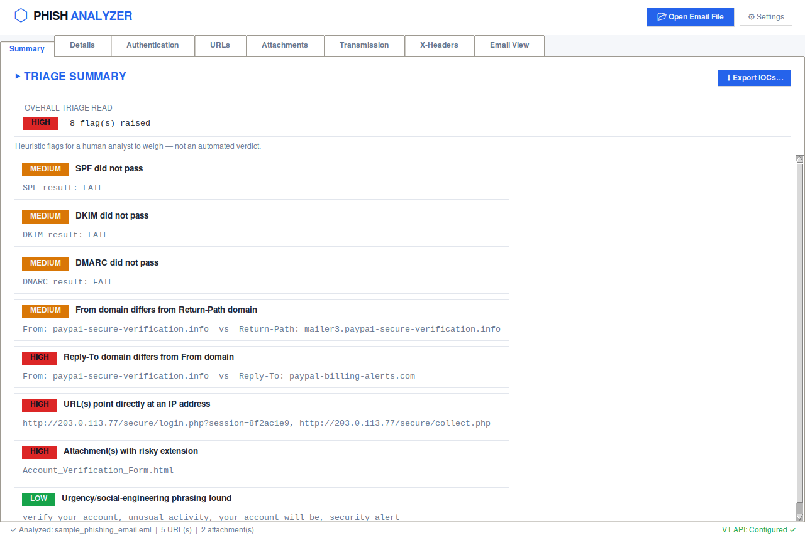
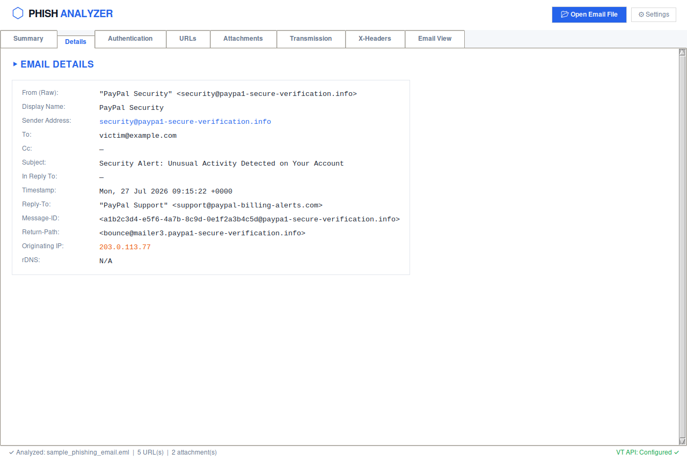
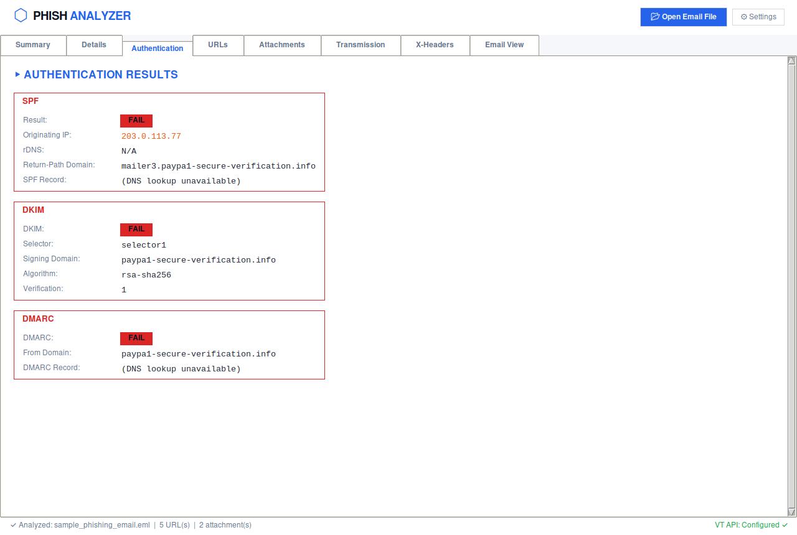
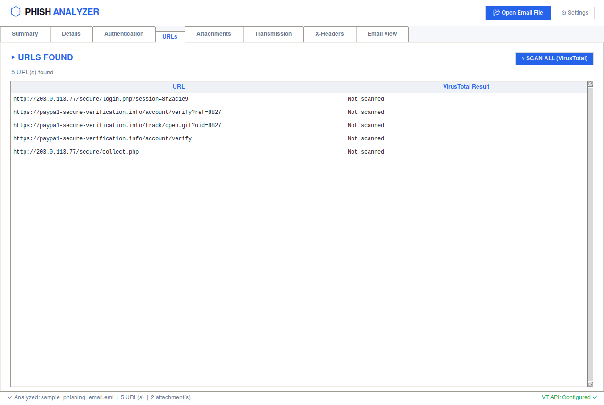
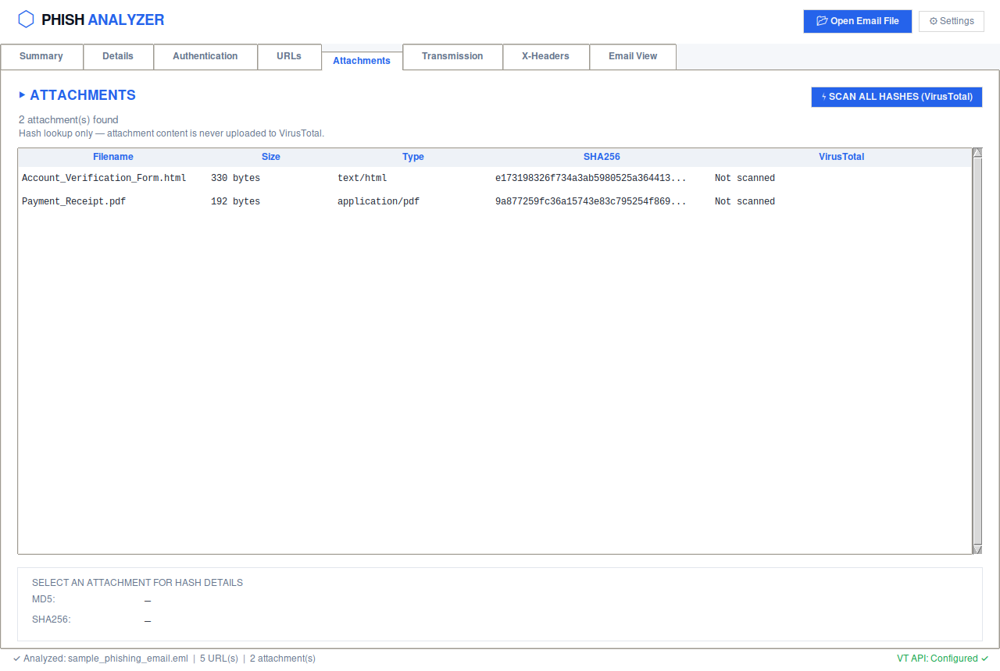
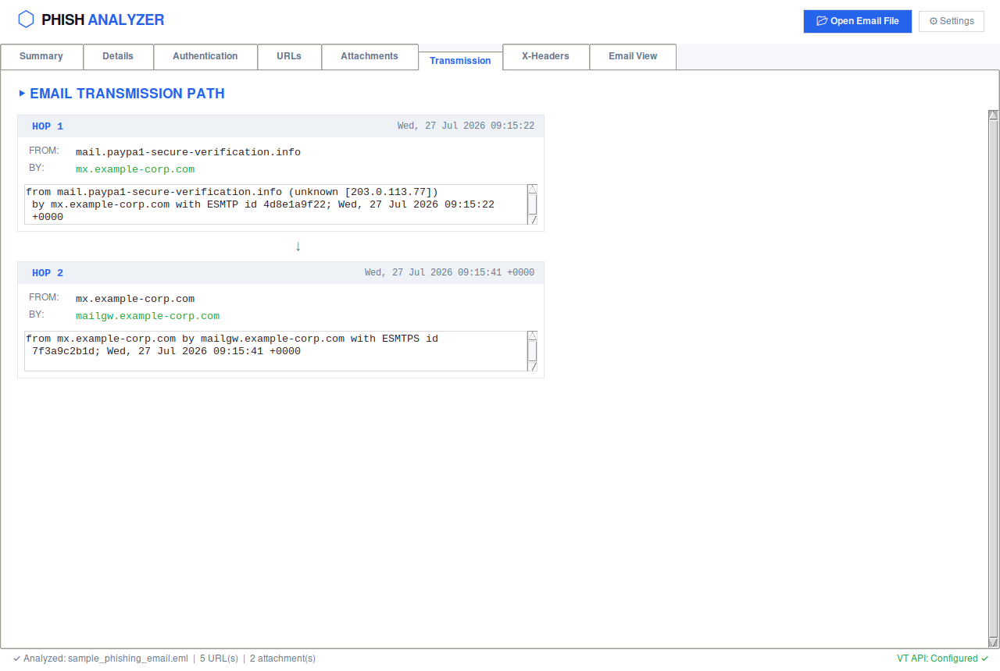
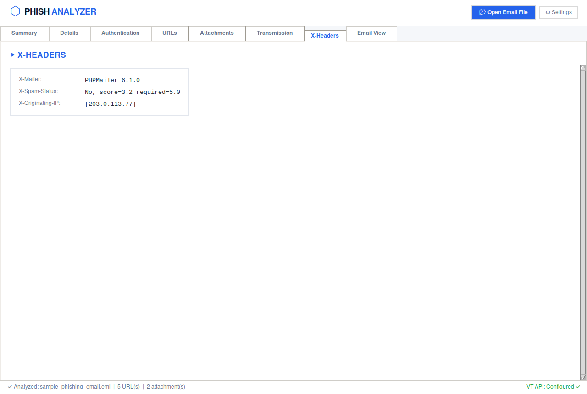
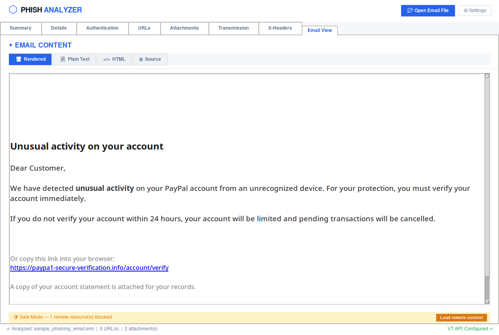
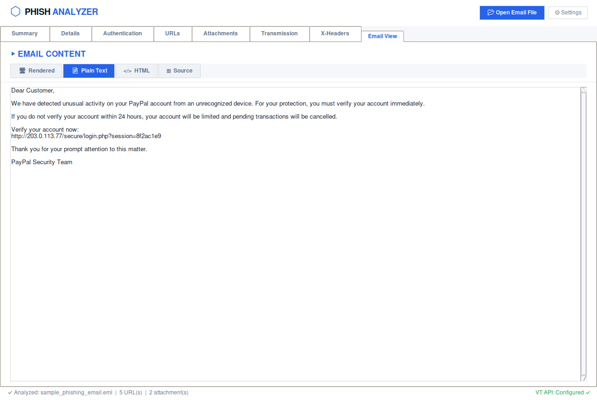
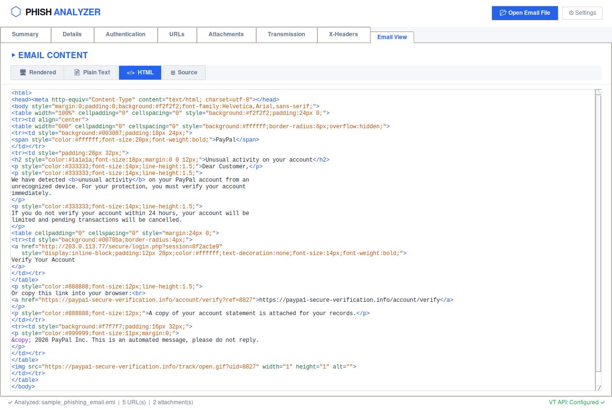

# PhishAnalyzer

A desktop tool for analyzing suspicious `.eml` and `.msg` files offline. Built
for triaging phishing reports without forwarding the sample anywhere.

## Features

- Parses RFC-5322 (`.eml`) and Outlook (`.msg`) files
- SPF / DKIM / DMARC and header authentication checks
- Originating IP + reverse DNS, transmission (`Received`) hop trace
- URL and attachment extraction with optional VirusTotal lookups
- Heuristic triage flags (urgency language, mismatched sender domains,
  risky attachment types, IP-literal links, etc.)
- IOC export (CSV/JSON)
- Email viewer with safe-by-default HTML rendering: remote images and
  stylesheets are blocked unless explicitly allowed, so opening a sample
  can't tip off the sender via tracking pixels
- Link clicks require confirmation and show the real destination first

## Install

Requires Python 3.10+.

```
python -m venv .venv
source .venv/bin/activate
pip install -r requirements.txt
```

## Usage

```
python main.py
```

Open an `.eml` or `.msg` file from the UI or drag one onto the drop zone.

VirusTotal lookups are optional — add an API key under Settings to enable
URL/attachment scanning.

## Windows build

A portable `PhishAnalyzer.exe` is built by
[the GitHub Actions workflow](.github/workflows/build-windows.yml) on every
push to `master`, or on demand from the Actions tab ("Run workflow"). That
run's build is downloadable from its Artifacts section, but artifacts expire
after 90 days.

For a permanent download, push a version tag — this also publishes the exe
to the repo's Releases page:

```
git tag v1.0.0
git push origin v1.0.0
```

## Example

[`samples/sample_phishing_email.eml`](samples/sample_phishing_email.eml) is a
fabricated PayPal-themed phishing email (fake domains, RFC 5737 example IPs,
no real infrastructure) used to exercise every tab. Open it in the app to
try it yourself.

**Summary** — overall verdict and every heuristic flag raised, with detail



**Details** — sender, recipients, originating IP



**Authentication** — SPF / DKIM / DMARC results



**URLs** — every link found in the body, ready for VirusTotal lookup



**Attachments** — filenames, hashes, risky-extension detection



**Transmission** — `Received` hop-by-hop path



**X-Headers** — mailer and spam-filter headers



**Email View — Rendered** — HTML body with Safe Mode blocking the tracking pixel



**Email View — Plain Text**



**Email View — HTML source** — syntax-highlighted raw markup



## Notes

This is a triage aid, not a verdict engine. The heuristic flags point at
evidence worth a human look; they don't classify anything as malicious on
their own.
